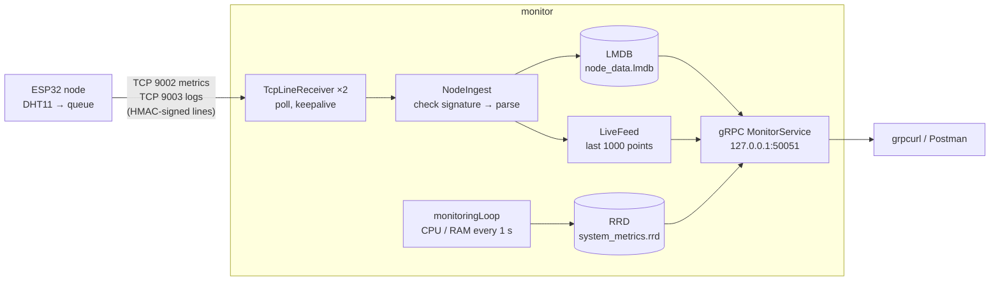

# monitor

A small C++20 server that receives temperature and humidity from an ESP32 node over TCP, checks that every
line is signed by the node, stores the data in LMDB, records this computer's own CPU and RAM in RRD, and
serves everything through a read-only gRPC API, including a live stream of new points.

Part of a three-repository project:

| Repository | Role |
|---|---|
| [esp32-monitoring-node](https://github.com/poberezhnyipavlo/esp32-monitoring-node) | ESP32 firmware: DHT11, queue, TCP, OLED, black box |
| [metric-protocol](https://github.com/poberezhnyipavlo/metric-protocol) | the text wire format shared by both sides (C++17, no dependencies) |
| **monitor** (this one) | the receiver: TCP, HMAC check, LMDB, RRD, gRPC |



## What it does

- **Receives** two line-based TCP streams from the node: metrics on 9002, event logs on 9003
  (format: [`metric-protocol`](https://github.com/poberezhnyipavlo/metric-protocol) 3.1).
- **Checks** the HMAC-SHA256 signature of every line before parsing it. Unsigned lines and lines signed with
  another key are rejected and logged with the reason.
- **Stores** node data in LMDB: every point by series and time, and a `dev|boot|seq` key per line, so a line
  that arrives twice (resend after a reconnect, replay) is stored once.
- **Records** this computer's CPU and memory every second in an RRD file (last 100 s).
- **Serves** a read-only gRPC API: list series, read a series for a time range, or stream new node points
  as they arrive.

## gRPC API

[`proto/monitor/v1/monitor.proto`](proto/monitor/v1/monitor.proto), with server reflection (no `.proto` needed
in the client):

| RPC | Kind | Returns |
|---|---|---|
| `ListSeries` | unary | every series: `host/cpu`, `host/memory`, `<node MAC>/temperature_c`, … |
| `GetSeries` | unary | points of one series in `[from_ms, to_ms]` (`to_ms = 0` = now), oldest first |
| `WatchLatest` | server streaming | new node points as they are stored, until the client cancels; filter by device and/or name |

```bash
grpcurl -plaintext 127.0.0.1:50051 monitor.v1.MonitorService/ListSeries
grpcurl -plaintext -d '{"id": {"device": "host", "name": "cpu"}}' \
    127.0.0.1:50051 monitor.v1.MonitorService/GetSeries
grpcurl -plaintext -d '{"id": {"name": "temperature_c"}}' \
    127.0.0.1:50051 monitor.v1.MonitorService/WatchLatest
```

`uint64` times come as strings in JSON (`"tsMs": "1795198041029"`): JSON numbers in JavaScript have 53 bits.
A value of `0` is not shown at all (`temp_alert` normal, idle CPU): proto3 does not send default values.

## Security: signed lines

The node and the monitor share a 32-byte key. The node appends `sig=<HMAC-SHA256 of the line, 64 hex>` to every
line; the monitor computes the same with its copy of the key and compares in constant time (`CRYPTO_memcmp`,
not `==`, so the time of a "no" does not tell how much of a forged MAC was right).

- Node: mbedTLS (part of the ESP32 core). Monitor: OpenSSL. Same algorithm, checked against the RFC 4231 test
  vectors and against `openssl dgst`.
- The signature format lives in `metric-protocol` (`Signature.h`); the library computes nothing itself and
  stays free of crypto dependencies.
- Replays are caught by the existing `dev|boot|seq` key: a recorded line is stored once; a new `boot`/`seq`
  cannot be signed without the key.
- Rejected lines are logged with the reason (`unsigned` / `bad signature`); bytes outside printable ASCII are
  replaced with `?`, so a line from an attacker cannot send escape sequences to the terminal showing the log.

What it does **not** do:

- **No secrecy.** Lines travel in clear text; HMAC proves who sent a line and that it was not changed. Secrecy
  would need TLS or AEAD.
- **The key can be read from the node's flash** by anyone holding the board (`esptool read_flash`). Flash
  encryption and secure boot would close that; not done.
- **No acknowledgements.** The protocol is one-way: the node drops a line from its queue once TCP accepted it.
  A line the monitor rejects (wrong key) or loses (connection cut mid-send) is gone. The fix is an `ack`
  in the protocol — at-least-once delivery, with the `dev|boot|seq` key already turning duplicates into
  exactly-once storage.
- **No rate limit** on rejected lines: someone flooding the port grows the log.

## Numbers

Measured on the hardware (ESP32-WROOM-32 + DHT11, macOS receiver) unless said otherwise.

| What | Value |
|---|---|
| Tests | monitor: 31 (GoogleTest); `metric-protocol`: 49 |
| Half-open connection detected (node reset with EN) | ~11 s (`Connection reset by peer`) |
| Half-open connection detected (node reflashed) | 30 s (`Operation timed out`: keepalive 15 s + 3 × 5 s) |
| Silent metrics connection closed | 10 s without a line |
| Store and forward: monitor stopped for ~60 s | node delivered the backlog with `age_ms` 60118 → 118 in steps of 2000, no `seq` gaps |
| Live stream buffer | last 1000 points; a client that falls further behind skips the oldest |
| RRD window | 100 s at a 1 s step |
| Shutdown (Ctrl+C) | ~1.5–3 s, most of it in gRPC's own threads after `main` |
| Node firmware with signing | RAM 78 152 B (23.9 %), flash 973 816 B (74.3 %); `net` task stack free 5 708 of 8 192 B |

## Build and run

Needs C++20, CMake ≥ 3.25, pkg-config, librrd, LMDB, gRPC + protobuf, OpenSSL.
`metric-protocol` and GoogleTest come through `FetchContent`.

### macOS

```bash
brew install cmake pkg-config rrdtool lmdb grpc openssl grpcurl
cmake -S . -B build && cmake --build build && (cd build && ctest)

export MONITOR_HMAC_KEY=$("$(brew --prefix openssl)/bin/openssl" rand -hex 32)  # the same key goes to the node's secrets.h
./build/monitor
```

### Linux (Docker, Ubuntu 24.04)

The container has the compiler and the libraries; the sources stay on the host, the database in a Docker volume.

```bash
export MONITOR_HMAC_KEY=<the same key as on the node>
docker compose build
docker compose up -d
docker compose exec linux-dev bash

# inside the container
cmake -S . -B build-linux && cmake --build build-linux -j"$(nproc)" && (cd build-linux && ctest)
cd /data && /app/build-linux/monitor
```

Ports 9002 and 9003 are forwarded, so the node keeps sending to the host. gRPC listens on the container's
`127.0.0.1`: use `grpcurl` from a second `docker compose exec linux-dev bash`.

Checked on macOS (Apple clang, librrd 1.11) and Ubuntu 24.04 (g++ 13, CMake 3.28, gRPC 1.51, librrd 1.7.2).

### Without the node

Any line can be signed from a shell:

```bash
P='ver=2 dev=aa:bb:cc:dd:ee:ff boot=00000001 seq=0 age_ms=0 name=temperature_c value=21.5'
S=$(printf '%s' "$P" | openssl dgst -sha256 -mac HMAC -macopt hexkey:$MONITOR_HMAC_KEY | awk '{print $NF}')
printf '%s sig=%s\n' "$P" "$S" | nc -w1 127.0.0.1 9002
```

## Design notes

- **LMDB keys.** `samples`: `dev(6) | boot(4) | seq(4)` → time, insert with `MDB_NOOVERWRITE` — an existing key
  means a duplicate. `series`: `dev(6) | name | 0x00 | ts_ms(8, big-endian)` → value: big-endian so that byte
  order equals time order, and a cursor walks a series oldest first; `0x00` ends the name so `temp` and
  `temp_alert` never mix. Listing series jumps from one series to the next instead of reading every point.
- **One interface, two stores.** `ISeriesStore` is implemented by LMDB (node data) and RRD (`host`); the gRPC
  service does not know which one answers.
- **Threads.** Two TCP receivers, the CPU/RAM loop and the gRPC server threads. `LiveFeed` hands points from
  the receiver thread to the stream threads: mutex + `condition_variable`, a cursor per reader instead of a
  queue per client. Checked with ThreadSanitizer.
- **C APIs behind RAII.** LMDB environment, transactions and cursors; the memory `rrd_fetch_r` allocates — taken
  over only when the call succeeded.
- **Values are rounded to 0.1 on the node**, not sent as fixed-point integers. Integers of tenths
  (`temp_dc=254`, like money in cents or CAN signals with a 0.1 scale) would be exact and compact; the text
  protocol and the lack of arithmetic on values made rounding enough for now, and integers would mean a new
  protocol version in all three repositories.

## Bugs worth remembering

- **`GetSeries host/cpu` crashed the server on Linux only.** Without `from_ms` the RRD was asked for data
  since 1970 at a 1 s step; librrd 1.7 failed to allocate it, and our cleanup then freed the outputs of the
  failed call. Found with `gdb` (`SIGSEGV in free()` ← `~FetchResult`) and a ten-line test program around
  `rrd_fetch_r`. Fixed twice: ask only for the window the RRD keeps, and own `rrd_fetch_r`'s memory only after
  it succeeded.
- **Every signed line rejected as `bad signature` on the hardware**, with `sig=000…000`. Native tests used a
  fake signer; the real one called mbedTLS with the wrong algorithm constant, got no hash, and fell back to an
  all-zero MAC. The fallback was chosen to be visible in the monitor's log, and that is how it was found.
- **Timestamps in microseconds** on macOS (`count()` of `system_clock` without `duration_cast`), found by
  reading the keys back with `mdb_dump`.

## Known limitations

- The gRPC API has no authentication, so it listens on `127.0.0.1` only.
- macOS memory shows ~96 %: inactive memory is counted as used.
- Each open `WatchLatest` stream holds a thread of the synchronous gRPC server; thousands of clients would need
  the async API.
- Logs are stored but not served by the API yet (`GetLogs` is the next step).